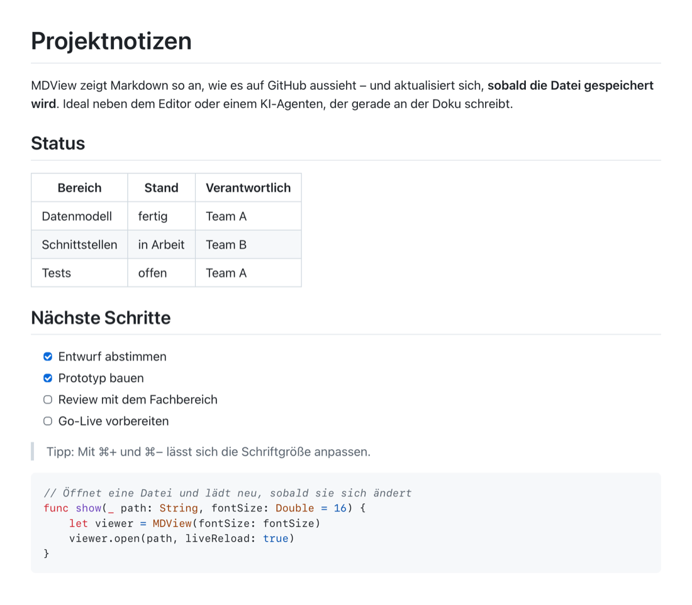
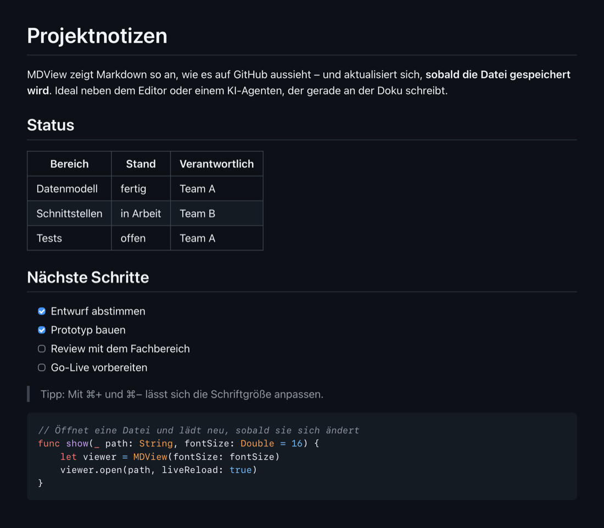

<p align="center">
  
</p>

<h1 align="center">MDView</h1>

<p align="center">
  Ein minimaler, schnell startender Markdown-Viewer für macOS –<br>
  nativ, ohne Electron, ohne Netzwerk, mit Live-Reload.
</p>

<p align="center">
  
  
</p>

---

## Warum?

Markdown-Dateien sind überall: READMEs, Projektnotizen, Dokus, Protokolle – und
zunehmend auch das, was KI-Agenten wie Claude Code schreiben. Zum **Lesen** sind die
üblichen Wege aber unbefriedigend:

- **Editoren** (VS Code, Typora, …) sind zum Schreiben gebaut, starten langsam und
  zeigen oft Quelltext statt fertiger Seite.
- **Quick Look** zeigt nur Rohtext.
- **Browser-Erweiterungen und Electron-Apps** sind schwergewichtig und laden gern
  etwas aus dem Netz nach.

MDView macht genau eine Sache: eine Markdown-Datei **schön anzeigen** – im Stil von
GitHub, in Hell oder Dunkel – und sich **sofort aktualisieren**, wenn die Datei
gespeichert wird. Typischer Einsatz: MDView-Fenster neben dem Editor oder neben dem
Terminal, in dem ein Agent gerade die Doku schreibt, und man sieht live das Ergebnis.
Die Scrollposition bleibt dabei stehen.

## Funktionen

- **Schnell:** natives Swift/AppKit, ein Fenster pro Datei, startet in rund einer halben Sekunde.
- **Live-Reload:** erkennt Änderungen sofort – auch beim „atomaren Speichern“, das
  viele Editoren nutzen (Datei wird ersetzt statt überschrieben).
- **Scrollposition bleibt:** beim Neuladen werden nur geänderte Abschnitte ausgetauscht.
- **GitHub-Flavored Markdown:** Tabellen, Task-Listen, Codeblöcke mit Syntax-Highlighting
  (rund 35 gängige Sprachen), Zitate, Bilder.
- **Hell & Dunkel:** folgt automatisch der macOS-Einstellung.
- **Relative Links und Bilder** funktionieren (relativ zum Ordner der Datei);
  verlinkte `.md`-Dateien öffnen in MDView, Webseiten im Standardbrowser.
- **Offline & sicher:** keine Netzwerkzugriffe, Skripte aus Markdown-Dateien werden nicht ausgeführt.
- **Überall öffnen:** Doppelklick im Finder, „Öffnen mit“, Drag & Drop aufs Dock-Icon
  oder Fenster, `open -a MDView datei.md`, ⌘O.

## Installation

Voraussetzungen: macOS 12 oder neuer und die Xcode Command Line Tools
(für `swiftc`; ein komplettes Xcode ist nicht nötig).

```bash
xcode-select --install
```

### Mit Homebrew

```bash
brew install tissanr/tap/mdview
```

Homebrew baut MDView dabei aus dem Quellcode. Danach im Terminal `mdview datei.md`.
Beim ersten Aufruf verlinkt `mdview` die App automatisch nach `~/Applications`, damit sie
auch im Finder, in Spotlight und bei „Öffnen mit“ erscheint. Wer das sofort möchte, ruft
einmal `mdview` ohne Datei auf.

(Während `brew install` selbst geht das nicht: Homebrew installiert in einer Sandbox,
die keine Schreibzugriffe ins Home-Verzeichnis erlaubt.)

Falls Homebrew nach Vertrauen für das Tap fragt: `brew trust --tap tissanr/tap`.

### Aus dem Quellcode

```bash
git clone https://github.com/tissanr/MumMD.git
```

```bash
cd MumMD && ./build.sh
```

`build.sh` lädt beim ersten Mal [marked.js](https://github.com/markedjs/marked) und
[highlight.js](https://highlightjs.org) in einer festen Version (Prüfsummen werden
kontrolliert), kompiliert die App und legt
`MDView.app` nach `~/Applications`.

### Als Standard-App für Markdown setzen

1. Im Finder eine `.md`-Datei auswählen und **⌘I** drücken (Informationen).
2. Unter **„Öffnen mit:“** MDView auswählen.
3. **„Alle ändern …“** klicken und bestätigen.

Ab dann öffnet ein Doppelklick jede `.md`-Datei in MDView.

## Bedienung

| Taste        | Aktion                         |
|--------------|--------------------------------|
| ⌘O           | Datei öffnen                   |
| ⌘R           | Neu laden                      |
| ⌘+ / ⌘− / ⌘0 | Schrift größer / kleiner / normal |
| ⌘W           | Fenster schließen              |
| ⌘Q           | Beenden                        |

Die Schriftgröße gilt für alle Fenster und wird gespeichert.

## Wie es funktioniert

Das ganze Projekt besteht aus wenigen Dateien:

| Datei           | Zweck |
|-----------------|-------|
| `main.swift`    | Die App: Fenster, Menüs, Dateiüberwachung, Öffnen per Finder/Dock/Drag & Drop |
| `template.html` | Die Seite im Fenster; rendert Markdown mit marked.js, färbt Codeblöcke mit highlight.js und tauscht Inhalte aus |
| `style.css`     | GitHub-ähnliches Layout, Hell/Dunkel, max. 900 px Textbreite |
| `Info.plist`    | App-Beschreibung; meldet MDView bei macOS als Viewer für `.md`/`.markdown` an |
| `icon.svg`      | Das App-Icon; wird beim Bauen in `AppIcon.icns` umgewandelt |
| `build.sh`      | Baut alles nur mit `swiftc` – kein Xcode-Projekt |

Ein paar Details:

- **Dateiüberwachung** per `DispatchSource` (kqueue). Wird die Datei ersetzt, umbenannt
  oder gelöscht, setzt MDView die Überwachung auf den Pfad neu auf. Ereignisse werden
  ~100 ms entprellt, damit pro Speichervorgang genau einmal neu gerendert wird.
- **Neuladen ohne Springen:** Das neue HTML wird mit dem alten verglichen; nur geänderte
  Blöcke werden ersetzt. Bereits geladene Bilder bleiben, die Seite springt nicht.
- **Sicherheit:** Eine Content-Security-Policy sperrt Netzwerkzugriffe und Skripte aus
  dem Dokument. Links ins Web öffnen im Standardbrowser, nicht in der App.

## Grenzen

Bewusst weggelassen, um klein und schnell zu bleiben:

- Bilder aus dem Internet (z. B. Badges) werden nicht geladen – das ist die Kehrseite von
  „keine Netzwerkzugriffe“. Erlauben lässt es sich in `template.html` (`img-src … https:`).
- Keine Mermaid-Diagramme, keine Formeln. Codeblöcke ohne Sprachangabe bleiben ungefärbt.
- Kein Bearbeiten – MDView ist ein reiner Viewer.
- Noch keine Suche im Dokument (⌘F).
- Die App wird nur lokal signiert. Auf dem eigenen Mac ist das kein Problem; wer die
  fertige App weitergibt, muss sie dort beim ersten Start per Rechtsklick → „Öffnen“ starten.

## Entwicklung

Nach jeder Änderung einfach `./build.sh` erneut ausführen.

Für automatische Tests gibt es Umgebungsvariablen, z. B.
`open -a MDView --env MDVIEW_DEBUG=1 --stderr log.txt datei.md`:

| Variable                     | Wirkung |
|------------------------------|---------|
| `MDVIEW_DEBUG=1`             | Schreibt jedes Rendern auf stderr |
| `MDVIEW_DEBUG_SNAPSHOT=<dir>`| Speichert nach jedem Rendern ein PNG |
| `MDVIEW_DEBUG_SCROLL=<px>`   | Scrollt nach dem ersten Rendern |
| `MDVIEW_DEBUG_APPEARANCE=dark\|light` | Erzwingt Hell oder Dunkel |

Die Screenshots oben sind so entstanden, aus [`docs/demo.md`](docs/demo.md).

## Lizenz

[GPL-3.0](LICENSE). Enthält [marked](https://github.com/markedjs/marked) (MIT-Lizenz)
und [highlight.js](https://github.com/highlightjs/highlight.js) (BSD-3-Clause), die beim
Bauen geladen werden.
